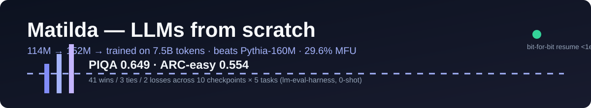

<p align="center">
  
</p>

# Matilda — LLMs Trained From Scratch

Decoder-only transformers trained from the ground up in **pure PyTorch — no training frameworks** — with a production-grade training stack: crash-safe checkpoints, NaN/Inf fault tolerance, SIGTERM handling, SHA-256-verified data pipelines, and MFU observability.

> Hugging Face: [prometheus04/matilda-mini](https://huggingface.co/prometheus04/matilda-mini) · [matilda-mini-v2](https://huggingface.co/prometheus04/matilda-mini-v2) · [matilda-152m-v15-7.5B](https://huggingface.co/prometheus04/matilda-152m-v15-7.5B)

## The three generations

| | **v1 — Matilda-Mini** | **v1.5 — Matilda-152M** | **v2 — Matilda-mini-v2 (infra)** |
|---|---|---|---|
| Params | 114M | 152M | 152M hero config |
| Architecture | 12L×768, SwiGLU, GQA 12/4, QK-Norm, tied embeddings | 18L, GQA, RoPE, QK-Norm, ReLU² FFN, logit soft-cap | 18L×768×12 heads, 4 KV heads, seq 2048, ReLU², soft-cap 30.0, z-loss 1e-4 |
| Training | ~3B FineWeb-Edu tokens | **7.5B tokens in ~23h on 1×A100** | hybrid **Muon + AdamW**, **WSD** 700/5160/1290, Liger kernels |
| Efficiency | **53.4% MFU** on RTX 3090 (torch.compile) | 29.6% avg MFU | — |
| Tests | 30/30 GPU correctness + resume | — | 35 tests, bit-for-bit resume (<1e-6) |

## vs Pythia-160M (token-matched, 0-shot)

| Task | Matilda-152M | Pythia-160M | Δ |
|---|---|---|---|
| PIQA | **0.649** | 0.592 | **+5.7 pt** |
| ARC-easy | **0.554** | 0.419 | **+13.5 pt** |
| HellaSwag (acc_norm) | **0.347** | 0.275 | **+7.2 pt** |
| LAMBADA | **0.287** | 0.248 | **+4.0 pt** |
| Winogrande | 0.526 | 0.529 | −0.3 (tie) |

**41 wins / 3 ties / 2 losses** across 10 checkpoints × 5 tasks (lm-eval-harness).

**What “token-matched” means, precisely.** Comparisons use the closest checkpoint by tokens seen: Matilda-152M at **7.50B tokens** vs Pythia-160M step 4000 (**8.39B tokens**). Pythia-160M's final model was trained on **~300B tokens (~40× more)**, so this is a **compute-efficiency** comparison at equal budget — not a claim that a 7.5B-token model beats fully-trained Pythia-160M.

**This is not a clean architecture comparison.** Three confounds: (1) **data** — FineWeb-Edu-dedup (83.3%) + Cosmopedia v2 (16.7%), a 2024 quality-filtered/synthetic corpus, versus Pythia's The Pile (released 2020, not deduplicated for this checkpoint); (2) **capacity** — 113M non-embedding parameters (18 layers, tied embeddings, 152M total) versus Pythia-160M's 85M non-embedding (12 layers, untied embeddings, 162M total); (3) **recipe** — Muon+AdamW, WSD, QK-norm, ReLU² FFN and logit soft-cap. The result supports “a modern small-model recipe reaches Pythia-160M parity at ~1/40th the tokens”, not “our architecture is better”. Pythia was also designed for interpretability research rather than downstream benchmark performance.

## Ablations

- [Muon vs AdamW at 124M / 300M tokens](docs/ablation-muon-vs-adamw.md) — matched-token A/B: Muon 3.5570 vs AdamW 3.7236 (−0.167 nats, ~15% lower perplexity), 2026-05-30, plus the independent 2026-06-10 Maincode follow-up at matched loss.

## Infrastructure highlights

- **Crash-safe training**: bit-for-bit checkpoint resume (<1e-6), NaN/Inf guards, SIGTERM spot-instance handling — multi-day runs never restart from zero
- **Data integrity**: mmap'd pipeline over FineWeb-Edu + Cosmopedia, SHA-256 manifest, EOT token control
- **Optimization**: hybrid Muon (2D, lr 0.02) + AdamW with WSD schedule; Liger fused RMSNorm + linear+CE; MFU monitor
- **Eval rigor**: per-checkpoint curves, 10 checkpoints × 5 tasks, conversion + parity tooling

## Repo layout

```
matilda-mini/            v1 code + training stack (114M)
matilda-mini-v2/         v2 infra + 152M hero config + tests
matilda-152m-v15-7.5B/   the hero run: checkpoints index, metrics.jsonl, eval/ (10 JSON + summary)
```

Model weights (large) live on Hugging Face — this repo carries code, configs, metrics and eval results.

